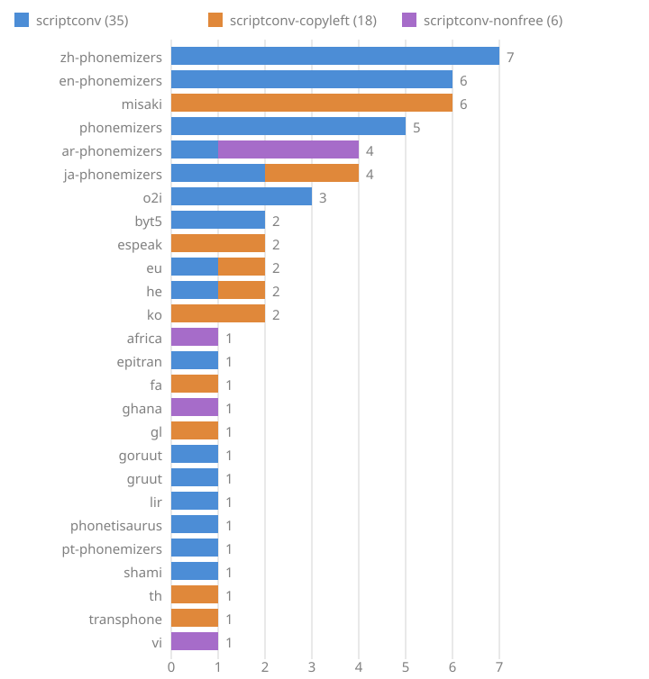

# Phonemizer backends

<!-- agent-hint
covers: every phonemizer backend, its class, its extra, its package and its language default, and the models that download
source: scriptconv/phonemizers/enums.py, registry.py and _moved.py for the table, through scripts/backend_table.py. The download code in scriptconv/diacritics.py and scriptconv/phonemizers/g2pw.py, en.py, leokani.py, lir.py, mul.py and nemo_ipa.py
generated: yes for the table between the backends markers, by scripts/backend_table.py, and for docs/figures/backends-by-extra.svg, by scripts/docs_figures.py. Edit the registry and run the script, not the output
verify: python scripts/docs_figures.py --check && python scripts/backend_table.py --check && python scripts/check_doc_page.py docs/backends.md
see: docs/phonemizers.md, docs/stack.md
-->

Each backend is a member of the `Phonemizer` enum. Its string value is wire
format: voice configuration files store it, so it never changes. The registry
maps each member to a class and to the extra that installs its engine.

## List the backends

The registry holds the list. This command prints the value of each backend:

```bash
python -c "from scriptconv.phonemizers import Phonemizer; print(' '.join(p.value for p in Phonemizer))"
```

## Check the table

The table has one row per `Phonemizer` member, in the order of the enum.
`scripts/backend_table.py` writes it from the registry. From the repository
root, `python scripts/backend_table.py` prints the table, `--write` rewrites it
in this page, and `--check` exits 1 when the page differs from the registry.
`tests/test_backend_table.py` runs `--check`.

## Backends by extra

Most extras install one or two backends. The figure counts the backends of
each extra, and colours each count by the package that holds the wrapper
code. scriptconv-copyleft and scriptconv-nonfree are the sister packages that
hold the restricted wrappers. The Licensing section of the
[README](../README.md#licensing) states the terms of each.



*Figure: the 59 backends by extra. Read the colour: the `misaki`, `espeak`,
`ko` and `th` extras install copyleft wrappers only, and `ar-phonemizers`,
`ja-phonemizers`, `eu` and `he` mix two packages.*

## The table

The Extra column names the extra to install. Each phonemizer extra includes
`phonemizers`, the base layer, and a backend with no engine package needs only
that. The Package column names the package that holds the wrapper code. The
last column names each language whose explicit default chain holds the backend.

<!-- backends:start -->
| Backend | Class | Extra | Package | Language default |
|---|---|---|---|---|
| `unicode` | `UnicodeCodepointPhonemizer` | `phonemizers` | scriptconv |  |
| `graphemes` | `GraphemePhonemizer` | `phonemizers` | scriptconv |  |
| `misaki` | `MisakiPhonemizer` | `misaki` | scriptconv-copyleft |  |
| `misaki_en` | `MisakiEnPhonemizer` | `misaki` | scriptconv-copyleft |  |
| `misaki_ja` | `MisakiJaPhonemizer` | `misaki` | scriptconv-copyleft |  |
| `misaki_zh` | `MisakiZhPhonemizer` | `misaki` | scriptconv-copyleft |  |
| `misaki_ko` | `MisakiKoPhonemizer` | `misaki` | scriptconv-copyleft |  |
| `misaki_vi` | `MisakiViPhonemizer` | `misaki` | scriptconv-copyleft |  |
| `espeak` | `EspeakPhonemizer` | `espeak` | scriptconv-copyleft | `gl`, `ru` |
| `espeak_lt_accent` | `EspeakLithuanianAccentPhonemizer` | `espeak` | scriptconv-copyleft |  |
| `gruut` | `GruutPhonemizer` | `gruut` | scriptconv |  |
| `goruut` | `GoruutPhonemizer` | `goruut` | scriptconv |  |
| `epitran` | `EpitranPhonemizer` | `epitran` | scriptconv |  |
| `byt5` | `ByT5Phonemizer` | `byt5` | scriptconv |  |
| `charsiu` | `CharsiuPhonemizer` | `byt5` | scriptconv |  |
| `transphone` | `TransphonePhonemizer` | `transphone` | scriptconv-copyleft |  |
| `phonetisaurus` | `PhonetisaurusPhonemizer` | `phonetisaurus` | scriptconv |  |
| `mwl_phonemizer` | `MirandesePhonemizer` | `o2i` | scriptconv | `mwl` |
| `deepphonemizer` | `DeepPhonemizer` | `en-phonemizers` | scriptconv |  |
| `openphonemizer` | `OpenPhonemizer` | `en-phonemizers` | scriptconv |  |
| `g2pen` | `G2PEnPhonemizer` | `en-phonemizers` | scriptconv |  |
| `dizione` | `DizionePhonemizer` | `en-phonemizers` | scriptconv |  |
| `leokani` | `LeokaniPhonemizer` | `en-phonemizers` | scriptconv |  |
| `nemo_ipa` | `NemoIpaPhonemizer` | `en-phonemizers` | scriptconv |  |
| `kolokwa` | `KolokwaPhonemizer` | `lir` | scriptconv | `lir` |
| `tugaphone` | `TugaphonePhonemizer` | `pt-phonemizers` | scriptconv | `pt` |
| `g2pfa` | `PersianPhonemizer` | `fa` | scriptconv-copyleft |  |
| `openjtalk` | `OpenJTaklPhonemizer` | `ja-phonemizers` | scriptconv |  |
| `openjtalk_prosody` | `OpenJTalkProsodyPhonemizer` | `ja-phonemizers` | scriptconv-copyleft |  |
| `cutlet` | `CutletPhonemizer` | `ja-phonemizers` | scriptconv |  |
| `pykakasi` | `PyKakasiPhonemizer` | `ja-phonemizers` | scriptconv-copyleft |  |
| `cotovia` | `CotoviaPhonemizer` | `gl` | scriptconv-copyleft | `gl` |
| `ahotts` | `AhoTTSPhonemizer` | `eu` | scriptconv-copyleft |  |
| `phonikud` | `PhonikudPhonemizer` | `he` | scriptconv | `he` |
| `hebrew_ipa` | `HebrewIPAPhonemizer` | `he` | scriptconv-copyleft |  |
| `tltk` | `TLTKPhonemizer` | `th` | scriptconv-copyleft |  |
| `mantoq` | `MantoqPhonemizer` | `ar-phonemizers` | scriptconv-nonfree |  |
| `halabi` | `HalabiPhonemizer` | `ar-phonemizers` | scriptconv-nonfree |  |
| `iqra` | `IqraPhonemizer` | `ar-phonemizers` | scriptconv-nonfree |  |
| `viphoneme` | `VIPhonemePhonemizer` | `vi` | scriptconv-nonfree |  |
| `g2pk` | `G2PKPhonemizer` | `ko` | scriptconv-copyleft |  |
| `kog2p` | `KoG2PPhonemizer` | `ko` | scriptconv-copyleft |  |
| `g2pc` | `G2pCPhonemizer` | `zh-phonemizers` | scriptconv |  |
| `g2pm` | `G2pMPhonemizer` | `zh-phonemizers` | scriptconv |  |
| `g2pw` | `G2PWPhonemizer` | `zh-phonemizers` | scriptconv |  |
| `pypinyin` | `PypinyinPhonemizer` | `zh-phonemizers` | scriptconv |  |
| `xpinyin` | `XpinyinPhonemizer` | `zh-phonemizers` | scriptconv |  |
| `jieba` | `JiebaPhonemizer` | `zh-phonemizers` | scriptconv |  |
| `f5tts_char` | `F5TTSCharPhonemizer` | `phonemizers` | scriptconv |  |
| `f5tts_pinyin` | `F5TTSPinyinPhonemizer` | `zh-phonemizers` | scriptconv |  |
| `vosk` | `VoskPhonemizer` | `phonemizers` | scriptconv | `ru` |
| `shami` | `ShamiPhonemizer` | `shami` | scriptconv |  |
| `arbtok` | `ArbtokPhonemizer` | `ar-phonemizers` | scriptconv | `ar` |
| `euskaphone` | `EuskaphonePhonemizer` | `eu` | scriptconv | `eu` |
| `barranquenho` | `BarranquenhoPhonemizer` | `o2i` | scriptconv |  |
| `orthography2ipa` | `Orthography2IPAPhonemizer` | `o2i` | scriptconv | `gl`, `ru` |
| `africa_g2p` | `AfricaG2PPhonemizer` | `africa` | scriptconv-nonfree |  |
| `ghana_g2p` | `GhanaG2PPhonemizer` | `ghana` | scriptconv-nonfree |  |
| `matoub_kab` | `MatoubKabylePhonemizer` | `phonemizers` | scriptconv |  |
<!-- backends:end -->

Two languages list `espeak` and `orthography2ipa` because their chains end
with them. Every other language without an explicit chain resolves to
orthography2ipa when it has a spec for the language, and to espeak otherwise.
`ar` never leaves its chain.

## Model files

ByT5, Charsiu and phonetisaurus never download a model. Each needs a local
model path through `model=`, and `get_phonemizer(backend, model=...)` passes
that path to the constructor. ByT5 and Charsiu also need `tokenizer_config=`,
the path of a local tokenizer JSON file. Without a model path, the
constructor raises an error:

```python
from scriptconv.phonemizers import Phonemizer, get_phonemizer

get_phonemizer(Phonemizer.BYT5)      # ValueError: ByT5 phonemization needs a local ONNX model file
get_phonemizer(Phonemizer.CHARSIU)   # ValueError: ByT5 phonemization needs a local ONNX model file
```

These models and data download on first use:

| Model or data | Used by | Downloaded by | Cache location |
|---|---|---|---|
| phonikud ONNX diacritizer | `diacritize(text, "he")` | `_default_phonikud_model` in `diacritics.py` | `scriptconv/phonikud` under `$SCRIPTCONV_CACHE`, else under `$XDG_CACHE_HOME` (default `~/.cache`) |
| Nakdimon diacritizer, pinned to a sha256 | `diacritize(text, "he", diacritizer_model="nakdimon")` | `_download_nakdimon` in `diacritics.py` | `scriptconv/nakdimon` under the same base directory |
| the fp32 weights of a text2tashkeel model, such as `rawi` | `diacritize(text, "ar", diacritizer_model="rawi")` | text2tashkeel | the Hugging Face cache |
| the stressonnx model of the language, from `TigreGotico/stressonnx-models` at a pinned revision | `diacritize(text, lang)` for a language in `STRESS_LANGS` | stressonnx | the Hugging Face cache |
| g2pW polyphone model, pinned to a sha256 | the `g2pw` backend | `g2pw.py` | the Hugging Face cache |
| the Leokani G2P lexicon and ONNX models of the `micro` or `mini` model, from `milliwattlabs/leokani-g2p` at a pinned revision, each pinned to a sha256 | the `leokani` backend | `LeokaniPhonemizer.__init__` in `leokani.py` | the Hugging Face cache |
| the NeMo IPA dictionary and the NeMo heteronyms file, in the copies of the Magpie TTS checkpoint, from `Phoonnx/magpietts-multi-357m-unicode` at a pinned revision, each pinned to a sha256 | the `nemo_ipa` backend | `NemoIpaPhonemizer.__init__` in `nemo_ipa.py` | the Hugging Face cache |
| the kolokwa-g2p ONNX model and its tables, from `TigreGotico/kolokwa-g2p-onnx` at a pinned revision, each pinned to a sha256 | the `kolokwa` backend | `KolokwaPhonemizer.__init__` in `lir.py` | the Hugging Face cache |
| a DeepPhonemizer checkpoint named in `DeepPhonemizer.MODELS` | the `deepphonemizer` backend | `DeepPhonemizer.__init__` in `en.py` | `~/.local/share/deepphonemizer` |

The default Arabic diacritizer, `rawi-ensemble`, and the INT8 text2tashkeel
models ship in the text2tashkeel wheel, so `diacritize(text, "ar")` downloads
nothing.

To skip a download, give a local file where the code accepts one:

- Hebrew: pass the path of a phonikud ONNX model through
  `diacritizer_model=`.
- DeepPhonemizer: pass the path of a checkpoint through `model=`.
- Nakdimon: put the file with the pinned sha256 in its cache location.
- NeMo IPA: pass the path of the dictionary through `dictionary=` and the path
  of the heteronyms file through `heteronyms=`.
- g2pen: install the NLTK data with
  `python -m nltk.downloader averaged_perceptron_tagger cmudict`. The installed
  NLTK may also need `averaged_perceptron_tagger_eng`; the error names every
  package that is missing. The backend reads the data from the NLTK data
  directory and downloads nothing. It checks the zip files that g2p_en looks
  for at import, then raises `ModelUnavailableError` when one is absent.

The g2pW backend takes no model path. Its constructor has only an `alphabet`
parameter, so `get_phonemizer(Phonemizer.G2PW, model=...)` raises `ValueError`.
Any backend whose constructor has no `model`, `engine` or `register` parameter
does the same. An empty string means no model. The kolokwa-g2p backend takes
no model path either. Leokani G2P takes a model name, `micro` or `mini`,
through `model=`. The g2pW, Leokani G2P and
kolokwa-g2p models, the stressonnx models and the fp32 text2tashkeel weights
come from the Hugging Face cache. To run these offline, fill the cache first
and then set `HF_HUB_OFFLINE=1`:

A backend that declares a `model` parameter still receives an empty string.
That value reaches the backend and may name no model there.

```python
import inspect
from scriptconv.phonemizers.g2pw import G2PWPhonemizer

list(inspect.signature(G2PWPhonemizer).parameters)   # ['alphabet']
```

Some engine packages download data of their own. For example, pygoruut
fetches its executable, and openphonemizer fetches its checkpoint from the
Hugging Face Hub. The documentation of each engine names its downloads.

## The phonetisaurus engine and its libraries

The `phonetisaurus` 0.3.0 wheel bundles its executables and most of their
shared objects under `phonetisaurus/lib/<machine>`: `libfst.so.13`,
`libmitlm.so.1`, `libgfortran.so.3` and the OpenFST companions. The binaries
find them only through the `PATH` and `LD_LIBRARY_PATH` that
`phonetisaurus.guess_environment()` builds. `phonetisaurus.predict` and
`phonetisaurus.train` pass that environment to every call. A binary started
with the plain shell environment exits with code 127 from the dynamic loader.

The wrapper only applies a model, and that path needs nothing more. Training
needs one object that the wheel does not bundle:

| Missing object | Needed by | Where it comes from |
|---|---|---|
| `libquadmath.so.0` | `estimate-ngram`, and so `phonetisaurus.train` | the GCC runtime: package `libquadmath0` on Debian and Ubuntu |

`MODEL_SOURCES` on the class names where to get a trained model. To train
one, run `phonetisaurus.train` on a lexicon such as CMUdict.
`tests/test_phonemizers_phonetisaurus_engine.py` runs the real engine when
`SCRIPTCONV_PHONETISAURUS_MODEL` names a trained FST, and skips with the
loader error or the missing model otherwise.

---
[Index](index.md) · [← ovos](ovos.md) · [performance →](performance.md)
