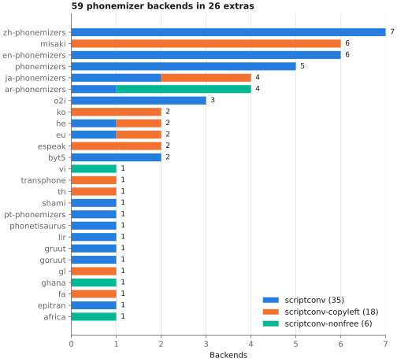

# scriptconv documentation

<!-- agent-hint
covers: the reading order of every page in docs/, and the subcommands of the command line
source: the pages in docs/, and scriptconv/__main__.py for the command line
generated: no
verify: python scripts/check_doc_page.py docs/index.md
see: README.md, AGENTS.md
-->

`scriptconv` finds the writing system of a text, rewrites it in another
script or phoneme notation, adds or removes its optional marks, and turns it
into phonemes through one of 59 backends.

<picture>
  <source media="(prefers-color-scheme: dark)" srcset="img/backends-by-extra-dark.svg">
  
</picture>

[backends.md](backends.md) lists each backend of this figure.

## Quickstart

```bash
uv pip install --prerelease=allow scriptconv
```

```python
from scriptconv import convert, detect_script, strip

detect_script("Здравствуйте")           # 'Cyrl'
convert("HH AH0 L OW1", "arpa", "ipa")  # 'həloʊ'
strip("مُحَمَّد", "tashkeel")             # 'محمد'
```

[install.md](install.md) gives the extra of each phonemizer backend.

## Pages

This index lists every page in reading order. The pages answer, in order of
depth: which writing system a text is in, how to rewrite it in another
representation, how to add or remove its optional marks, and how it sounds.

1. **[overview.md](overview.md)**: the four ideas of scriptconv, a tour of
   each module with examples, and the related projects.
2. **[install.md](install.md)**: the extras, the licence of the wheel and of
   each vendored part, and the sister packages.
3. **[stack.md](stack.md)**: where scriptconv sits in the speech stack. A
   walk-through of `TextFrontend` with a normaliser, the order of the stages,
   and the library that runs each stage.
4. **[scripts.md](scripts.md)**: writing-system identity. ISO 15924
   detection (`detect_script`, `char_script`), mixed-script runs
   (`script_runs`), text direction, the language-to-script map and the
   script metadata. The returned tags are stable API.
5. **[notation.md](notation.md)**: phoneme notations through the IPA hub:
   ARPABET with reversible stress, X-SAMPA, Kirshenbaum, Lexique, Cotovía,
   RFE, Buckwalter to Arabic and Halabi. The `errors=` policy and the
   `NOTATION_INFO` fidelity flags.
6. **[translit.md](translit.md)**: table-driven script rewrites: Hangul to
   jamo, hiragana to katakana, and hanzi to Cangjie codes.
7. **[readings.md](readings.md)**: respellings that need a dictionary: kanji
   to kana with the token stream, and hanzi to pinyin or bopomofo.
8. **[conventions.md](conventions.md)**: optional marks as data: tashkeel,
   kashida, Quranic marks, niqqud, teamim, wakachigaki, pinyin tones and jamo
   form, with `strip`, `apply`, `restyle` and `detect_convention`.
9. **[graph.md](graph.md)**: the conversion graph: nodes, edges, routing that
   prefers lossless edges, and explicit extension.
10. **[phonemizers.md](phonemizers.md)**: the phonemizer contract, the
   registry and the per-language defaults, identity, `diacritize` and the
   stress marks, the model-backed engines, the sister packages and the
   sentence gate.
11. **[frontend.md](frontend.md)**: every option of `TextFrontend`: inline
   phoneme blocks, chunk sizes, strict mode and its identity.
12. **[ovos.md](ovos.md)**: scriptconv phonemizers in OVOS through
    `ovos-scriptconv-g2p-plugin`.
13. **[backends.md](backends.md)**: every phonemizer backend with its class,
    extra, package and language default, the backends by extra in a figure,
    and the models that download on first use.
14. **[performance.md](performance.md)**: what the first call and a warm call
    cost, how time grows with text length, and the timing of the backend
    that reads whole text (dizione).
15. **[extending.md](extending.md)**: run your own backend in `TextFrontend`,
    and the steps that add a backend to the registry.
16. **[reference.md](reference.md)**: the signature and an example of each name
    that a voice engine imports, and the page of every other public name.

The command line, `python -m scriptconv`, has these subcommands: `convert`,
`detect`, `distribution`, `direction`, `decompose`, `lang`, `strip`,
`restyle`, `conventions`, `route` and `phonemize`.
`python -m scriptconv <subcommand> --help` shows the arguments of each one.
The other functions in these pages have no subcommand.
