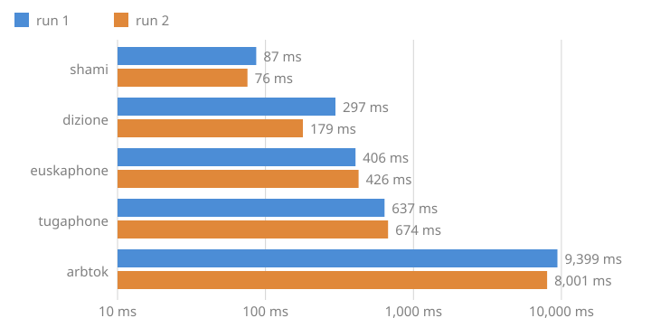

# Performance

<!-- agent-hint
covers: what a first call and a warm call cost, how time grows with text length, the timing of the backends that read whole text, and how to measure
source: scripts/time_owner_backends.py and scripts/time_owner_backends.txt, WHOLE_TEXT_LIMIT in scriptconv/frontend.py, scripts/docs_figures.py
generated: no, but docs/figures/owner-backend-timing.svg comes from scripts/docs_figures.py. Edit the script, not the SVG
verify: python scripts/docs_figures.py --check && python scripts/check_doc_page.py docs/performance.md
see: docs/frontend.md, docs/backends.md
-->

This page shows what a phonemizer call costs, how the cost grows with the
length of the text, and how to measure it on your own machine. Every number
comes from one laptop and one run, so read the shape, not the digits.

## The first call costs most

The first call of a backend imports its engine and loads its data or model.
Every later call reuses them. This script times both calls for tugaphone,
the Portuguese default:

```python
import time
from scriptconv.phonemizers import Phonemizer, get_phonemizer

backend = get_phonemizer(Phonemizer.TUGAPHONE)

start = time.perf_counter()
backend.phonemize_string("Olá mundo", "pt")
first = time.perf_counter() - start

start = time.perf_counter()
backend.phonemize_string("Olá mundo", "pt")
warm = time.perf_counter() - start
```

The measuring laptop gave `first` as 1.1 s and `warm` as 3 ms. A service
builds its backend once at start-up and calls it once on a short text, so
the first user request finds it warm. The module function `phonemize` builds
a backend on each call. It is fine for a script, and a loop should keep the
backend from `phonemizer_for_lang` instead.

## Time grows in a straight line with the text

A backend that reads sentence by sentence costs about the same per character
at every length. For tugaphone through `TextFrontend.phonemize_flat`, one
laptop gave these medians of three runs on repeated Portuguese sentences:

| Characters | Time |
|---|---|
| 100 | 15 ms |
| 1,000 | 146 ms |
| 5,000 | 841 ms |
| 10,000 | 1.7 s |

That is about 0.16 ms for each character. The methods `phonemize_lazy` and `segments` give the first sentence before
they read the rest. For 9,900 characters in 450 sentences, the
first list came after 0.11 s and the last after 1.6 s. A voice that speaks
as it reads should use `phonemize_lazy`. See [frontend.md](frontend.md#chunk-size)
for the chunk sizes.

## Backends differ by two orders of magnitude

The script `scripts/time_owner_backends.py` reads about 10,000 characters of
prose with each backend that reads text with its own rules, in five runs,
and reports the median. The figure shows the medians of two runs of the
script.



*Figure: milliseconds for one read of 10,000 characters, on a log scale. Read
the spread: arbtok, which restores the tashkeel before it transcribes, takes about 9 s where
shami takes under 0.1 s, so the choice of backend decides whether a long text
must be cut into chunks.*

## The whole-text limit

A backend that sets `reads_whole_text` gets the entire text in one call. The
cost of a dense text, one full of dates and prices, does not grow in a straight
line, and a blank line or a quotation mark adds more. The frontend therefore
cuts a text of more than `WHOLE_TEXT_LIMIT` characters at its paragraph breaks
before it passes the text to such a backend.

```python
from scriptconv.frontend import FrontendConfig, WHOLE_TEXT_LIMIT

WHOLE_TEXT_LIMIT                                    # 1750
FrontendConfig("en-US").whole_text_limit            # 1750
```

The limit is the largest size at which one dizione call on dense English
text stays under 100 ms in every run of the script. Set
`FrontendConfig.whole_text_limit` to a larger number, or to `None`, to turn
the cut off for offline work.

## Measure on your own machine

The script needs a directory with `en.txt`, `pt.txt`, `eu.txt` and `ar.txt`,
each with at least 10,000 characters of plain prose, and the extras of the
backends it times. A backend whose extra is missing is reported and skipped.

```bash
python scripts/time_owner_backends.py PROSE_DIR
```

---
[Index](index.md) · [← backends](backends.md) · [extending →](extending.md)
