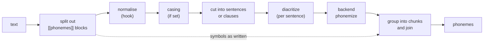

# scriptconv in the speech stack

<!-- agent-hint
covers: the stage order of TextFrontend and the library that runs each stage
source: scriptconv/frontend.py (module docstring, `TextFrontend._text_pieces`), `diacritize` in scriptconv/diacritics.py
generated: no
verify: python scripts/check_doc_page.py docs/stack.md
see: docs/frontend.md, docs/backends.md
-->

scriptconv is the one stop for text conversion in the TigreGotico speech
stack. A voice in [phoonnx](https://github.com/TigreGotico/phoonnx) builds a
`TextFrontend` from scriptconv and gives it text. The frontend calls the stage
libraries and one phonemizer backend, each through an optional extra.

## A walk-through

Install the normaliser and an espeak backend:

```bash
uv pip install --prerelease=allow "scriptconv[normalize,espeak]"
```

Build a frontend with `text2spoken` as its normalisation hook, and look at the
text after the stages:

```pycon
>>> from scriptconv.frontend import FrontendConfig, Stages, TextFrontend, spoken_normalizer
>>> from scriptconv.phonemizers import Phonemizer
>>> frontend = TextFrontend(FrontendConfig("pt-PT", Phonemizer.ESPEAK, normalizer=spoken_normalizer()))
>>> frontend.prepare("O Prof. Silva tem 25 anos.")
'O Professor Silva tem vinte e cinco anos.'

```

Without the hook, the same call returns the text as written:

```pycon
>>> plain = TextFrontend(FrontendConfig("pt-PT", Phonemizer.ESPEAK))
>>> plain.prepare("O Prof. Silva tem 25 anos.")
'O Prof. Silva tem 25 anos.'

```

`frontend.phonemize(text)` runs the same stages, then the backend, and returns
one list of phonemes per sentence. The raw text splits after `Prof.`, and the
normalised text does not:

```pycon
>>> len(frontend.phonemize("O Prof. Silva tem 25 anos."))
1
>>> len(plain.phonemize("O Prof. Silva tem 25 anos."))
2

```

## The order of the stages

Every method of `TextFrontend` runs one order:

1. Split out inline `[[phonemes]]` blocks. No stage reads a block.
2. Run the normalisation hook on the whole text, if the caller set one.
3. Apply casing, if the call sets a casing function.
4. Cut the text into sentences, or into clauses at `clause` chunk size.
5. For each sentence, diacritize, then run the backend.



*Figure: the stages of `TextFrontend`, left to right. The text inside an
inline block skips every stage and joins the output at the end. A backend that
owns a stage runs it itself, and the frontend skips that box.*

The hook runs before the sentence split. A split of raw text cuts after
`Prof.`, but `text2spoken` writes `Professor` and the split then sees one
sentence.

## Which library runs each stage

| Stage | Library | Extra | How scriptconv calls it |
|---|---|---|---|
| Normalise | [text2spoken](https://github.com/TigreGotico/text2spoken) | `normalize` | `spoken_normalizer()` returns `text2spoken.normalize` for the `normalizer` hook |
| Diacritize Arabic | [text2tashkeel](https://github.com/TigreGotico/text2tashkeel) | `tashkeel` | `scriptconv.diacritics.diacritize(text, "ar")` |
| Diacritize Hebrew | phonikud | `he` | `diacritize(text, "he")` |
| Restore stress | [stressonnx](https://github.com/TigreGotico/stressonnx) | `stress` | `diacritize(text, lang)` for a language in `STRESS_LANGS` |
| Mark Portuguese homographs | [bifonia](https://github.com/TigreGotico/bifonia) | `pt` | `diacritize(text, "pt")`, never for `pt-BR` |
| Phonemize | the backend: orthography2ipa, tugaphone, espeak and others | the extra of the backend | `get_phonemizer` or `phonemizer_for_lang` |

scriptconv does not own normalisation. The hook is off until the caller sets
it. A phonemizer library that reads raw text, such as tugaphone, runs
`text2spoken` in its own pipeline.

## Backends that run a stage themselves

A backend names the stages it runs itself in `owned_stages`, and the frontend
then skips them. tugaphone owns `normalize` and `diacritize`, arbtok owns
`diacritize`, and dizione and euskaphone own `normalize`. A backend that owns
`normalize` gets the text as written, so the caller's hook does not run for
it.

---
[← Prev](install.md) · [Home](index.md) · [Next →](scripts.md)
